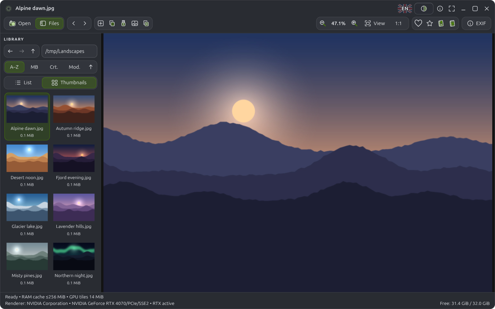

# ky-prism

Fast GPU photo viewer for Linux with a GTK 4 interface. Shows every photo
exactly as it is: colour-managed, pixel-exact at 1:1, never filtered.



## Installation

You need a desktop Linux with **GTK ≥ 4.12** and **Qt ≥ 6.4**. That covers
Ubuntu 24.04 or newer, Debian 13, Fedora 40 or newer, and Arch Linux and its
derivatives (Omarchy, Manjaro, EndeavourOS).

The installer works under your own account, in `~/.local`. It asks for your
password (`sudo`) only to install missing build packages from your
distribution's official repositories. Then it compiles the program, runs the
tests and adds **ky-prism** to the application menu.

### Ubuntu, Debian, Linux Mint, Pop!_OS

```bash
sudo apt install git python3
```

```bash
git clone https://github.com/rolandkorgowski/ky-prism.git
cd ky-prism
./run.sh install
```

### Fedora

```bash
sudo dnf install git python3
```

```bash
git clone https://github.com/rolandkorgowski/ky-prism.git
cd ky-prism
./run.sh install
```

### Arch Linux, Omarchy, Manjaro, EndeavourOS

```bash
sudo pacman -S --needed git python
```

```bash
git clone https://github.com/rolandkorgowski/ky-prism.git
cd ky-prism
./run.sh install
```

On Omarchy the installer also adds the ky-prism buttons to the top bar and
a Hyprland window rule.

### Starting the program

Open **ky-prism** from the application menu, or run it from a terminal:

```bash
ky-prism
```

```bash
ky-prism ~/Pictures/photo.jpg
```

If the `ky-prism` command is not found, log out and back in once, so that
`~/.local/bin` is added to your `PATH`.

### Updating

```bash
cd ky-prism && git pull && ./run.sh install
```

The previous version is backed up before every installation, in
`~/.local/state/omarchy-prism/install-backups/`.

### Optional: NVIDIA nvJPEG

On NVIDIA graphics with the CUDA Toolkit (≥ 12) installed, ky-prism also
builds a hardware JPEG decoder. It is optional; without CUDA the CPU decoder
is used and everything else works the same.

To see what is missing without installing anything:

```bash
./run.sh dependencies plan
```

## Features

- GPU canvas (OpenGL / OpenGL ES) with a tiled 16-bit pyramid; smooth zoom
  and panning even for very large photos, and exact 1:1 pixels.
- JPEG, PNG, TIFF and camera RAW files (Canon, Nikon, Sony, Fujifilm,
  Panasonic, Olympus, Pentax, DNG and others via LibRaw), with ICC colour
  management.
- Library with list and thumbnail views, natural sorting, tabs and
  side-by-side comparison of two photos.
- Copy the displayed photo to the clipboard (`Ctrl+C`): paste it as an image
  into editors and messengers, or as a file into a file manager.
- Export a byte-identical copy of the file, EXIF included, to a place and
  name you choose (`Ctrl+E`). Existing files are never overwritten.
- Right-click menu on the photo: copy, export, favourites, EXIF, full screen.
- Favourites, bookmarks, EXIF panel, copying to USB drives and duplicate
  search. Originals are never modified.
- Adjustable interface opacity (`Ctrl+Alt+O`). It changes only the toolbars
  and panels; the photo is always shown fully opaque.
- Follows the system's light/dark scheme and accent colour, and Omarchy themes.
- Polish and English interface.

Keyboard shortcuts are listed in [KEYBOARD.md](KEYBOARD.md), and inside the
program under `F1`.

## Instalacja po polsku (skrót)

1. Zainstaluj `git` i `python3`. Ubuntu/Debian: `sudo apt install git python3`.
   Fedora: `sudo dnf install git python3`. Arch/Omarchy:
   `sudo pacman -S --needed git python`.
2. Pobierz program i zainstaluj go:

   ```bash
   git clone https://github.com/rolandkorgowski/ky-prism.git
   cd ky-prism
   ./run.sh install
   ```

3. Uruchom **ky-prism** z menu aplikacji albo poleceniem `ky-prism`.

Aktualizacja: `cd ky-prism && git pull && ./run.sh install`.

## For developers

```bash
./run.sh build
```

```bash
./run.sh test
```

```bash
./run.sh run ~/Pictures/photo.jpg
```

`./run.sh test` also opens a real ky-prism window for about 15 seconds
(the `gtk_ui` test; it also uses the clipboard). For stability checks,
`./run.sh gtk-test --stress 20` repeatedly opens a 24-megapixel photo,
copies it to the clipboard and exports it, printing memory use and the
longest pause of the window per round. Change history and engineering notes are in
[docs/HISTORY.md](docs/HISTORY.md) (in Polish).

## License

Copyright © 2026 Krzysztof Kylen Lenartowicz. Released under the GNU General
Public License v3.0; see [LICENSE](LICENSE) and [COPYRIGHT.md](COPYRIGHT.md).
Libraries used by ky-prism (GTK, Qt, libvips, LibRaw, Little CMS and others)
keep their own authors and licences.
