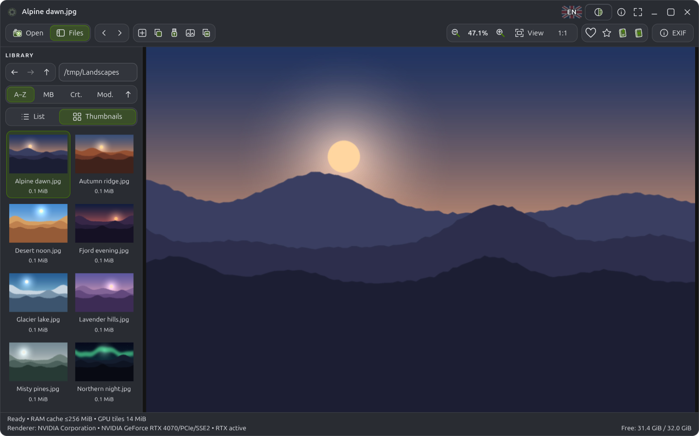

# ky-prism

Fast GPU photo viewer for Linux and BSD with a GTK 4 interface. Shows every photo
exactly as it is: colour-managed, pixel-exact at 1:1, never filtered.



## Installation

You need a desktop system with **GTK ≥ 4.12** and **Qt ≥ 6.4**. That covers
Ubuntu 24.04 or newer, Debian 13, Fedora 40 or newer, Arch Linux and its
derivatives (Omarchy, Manjaro, EndeavourOS), FreeBSD 14/15 and OpenBSD 7.6+.

The installer works under your own account, in `~/.local`. It asks for your
password (`sudo`, or `doas` on OpenBSD) only to install missing build
packages from your system's official repositories. Then it compiles the program, runs the
tests and adds **ky-prism** to the application menu.

### Ubuntu, Debian, Linux Mint, Pop!_OS

```bash
sudo apt install git python3
```

```bash
git clone https://github.com/rolandkorgowski/ky-prism.git
cd ky-prism
./run.sh install
```

### Fedora

```bash
sudo dnf install git python3
```

```bash
git clone https://github.com/rolandkorgowski/ky-prism.git
cd ky-prism
./run.sh install
```

### Arch Linux, Omarchy, Manjaro, EndeavourOS

```bash
sudo pacman -S --needed git python
```

```bash
git clone https://github.com/rolandkorgowski/ky-prism.git
cd ky-prism
./run.sh install
```

On Omarchy the installer also adds the ky-prism buttons to the top bar and
a Hyprland window rule.

### FreeBSD and OpenBSD

**What root is for.** Root is used for exactly one thing: installing system
packages (GTK, Qt, libvips, LibRaw, CMake, Python). On BSD only root may
install packages (`pkg`, `pkg_add`). Everything else (checking sources,
compiling, tests and installing ky-prism with its menu entry and icon)
runs as your user and writes only to your home directory (`~/.local`).
Installing system packages without root is not possible on BSD, so pick
who runs the package step:

**Option A: the script installs packages (sudo/doas).** As root, once:

FreeBSD:

```sh
pkg install -y git python3 sudo
```

Then run `visudo` and uncomment `%wheel ALL=(ALL:ALL) ALL`.

OpenBSD (the rule is appended, an existing `/etc/doas.conf` is kept):

```sh
pkg_add git python%3
```

```sh
grep -qx 'permit persist :wheel' /etc/doas.conf || echo 'permit persist :wheel' >> /etc/doas.conf
```

Then as your user (in the `wheel` group):

```sh
git clone https://github.com/rolandkorgowski/ky-prism.git
cd ky-prism
./run.sh install
```

`./run.sh install` installs the missing packages through `sudo`/`doas`,
asking for your password.

**Option B: no root in the script.** As root (you or the administrator),
once, install every package:

FreeBSD:

```sh
pkg install -y git cmake pkgconf python3 qt6-base gtk4 libepoxy vips libraw lcms2 jpeg-turbo libglvnd mesa-libs desktop-file-utils xdg-utils
```

OpenBSD:

```sh
pkg_add git cmake python%3 qt6-qtbase gtk+4 libvips libraw lcms2 jpeg desktop-file-utils xdg-utils
```

Then as your user (no `wheel`, sudo or doas needed):

```sh
git clone https://github.com/rolandkorgowski/ky-prism.git
cd ky-prism
./run.sh install --bez-roota
```

`--bez-roota` never calls `sudo` or `doas`. If a package is missing, it
stops and prints the exact command for root.

**How they differ.**

| | Option A | Option B |
| --- | --- | --- |
| Root once | Git, Python, sudo/doas rule | all packages |
| Your account | in `wheel`, may use sudo/doas | any account |
| `./run.sh install` | installs missing packages itself (asks for your password) | never elevates |
| A later version needs a new package | installed automatically | the script prints the command for root |
| Good for | your own computer | shared computers, accounts without admin rights |

On FreeBSD and OpenBSD, if the `ky-prism` command is not found in a
terminal, add `export PATH="$HOME/.local/bin:$PATH"` to `~/.profile`. The
application menu works without it. The USB-drive button needs `udisksctl`
and is Linux-only; on BSD mount the drive yourself and open its folder.
OpenBSD's libvips package has no ICC (lcms2) and no libexif support. Photos
with an embedded colour profile are therefore shown as sRGB, the EXIF panel
lists fewer fields, and CMYK files cannot be opened. Orientation still works,
because ky-prism reads it from EXIF itself.

### Starting the program

Open **ky-prism** from the application menu, or run it from a terminal:

```bash
ky-prism
```

```bash
ky-prism ~/Pictures/photo.jpg
```

If the `ky-prism` command is not found, log out and back in once, so that
`~/.local/bin` is added to your `PATH`.

### Updating

```bash
cd ky-prism && git pull && ./run.sh install
```

The previous version is backed up before every installation, in
`~/.local/state/omarchy-prism/install-backups/`.

## Backup and moving to another computer

```sh
./run.sh backup               # asks: settings only, or the whole program
./run.sh restore FILE         # settings back from a backup or an export
./run.sh export               # asks: another computer/system, or another account
```

- **`backup --ustawienia`** saves favourites, folder bookmarks, language and
  interface opacity to `backups/`. **`backup --program`** adds the sources,
  the git history and the built program. Backups never contain photos and
  never overwrite each other.
- **`export --system`** makes a package in `dist/` for another computer or
  operating system. It contains the sources, the git history and your
  settings, and the program is compiled there. **`export --konto`** also
  includes the ready program, for another account on the same system.

On the target, unpack the package and run `./run.sh`. It shows what it will
do, asks, then restores the settings and installs ky-prism. Every package
contains `INSTALACJA.txt`. Full guide in Polish:
[docs/INSTALACJA.md](docs/INSTALACJA.md).

### Optional: NVIDIA nvJPEG

On NVIDIA graphics with the CUDA Toolkit (≥ 12) installed, ky-prism also
builds a hardware JPEG decoder. It is optional; without CUDA the CPU decoder
is used and everything else works the same.

To see what is missing without installing anything:

```bash
./run.sh dependencies plan
```

## Features

- GPU canvas (OpenGL / OpenGL ES) with a tiled 16-bit pyramid; smooth zoom
  and panning even for very large photos, and exact 1:1 pixels.
- JPEG, PNG, TIFF and camera RAW files (Canon, Nikon, Sony, Fujifilm,
  Panasonic, Olympus, Pentax, DNG and others via LibRaw), with ICC colour
  management.
- Library with list and thumbnail views, natural sorting, tabs and
  side-by-side comparison of two photos.
- Copy the displayed photo to the clipboard (`Ctrl+C`): paste it as an image
  into editors and messengers, or as a file into a file manager.
- Export a byte-identical copy of the file, EXIF included, to a place and
  name you choose (`Ctrl+E`). Existing files are never overwritten.
- Printing (`Ctrl+P`) through the system print dialog, with printers detected
  from the system (CUPS) and their driver options. An extra **Zdjęcie** (Photo)
  tab sets photos per sheet (1–9, contact sheets), print size (fit, fill, actual
  size from the file's DPI, 9×13 to 20×30 cm, A5, A4 or custom), scale, margins,
  colour or greyscale, image quality (150/300/600 dpi), file names under photos,
  and shows a live preview of the sheet. Settings are remembered.
- Right-click menu on the photo: copy, export, print, favourites, EXIF, full
  screen.
- Drag and drop from the library (list and thumbnails): drag photos to other
  programs (copy only), onto the photo to open it, onto the second photo to
  compare, or onto a folder in the list to copy them there. A file of the
  same name is never overwritten without asking: Cancel, Skip existing or
  Overwrite; when the very same file is already there, a notice says so.
  Copies are written to a temporary file, synced to disk and then renamed in
  one step, so on Linux and BSD filesystems (ext4, btrfs, XFS, ZFS, UFS) an
  interruption or power cut leaves either the old or the new file, never a
  half-written one. FAT/exFAT drives do not guarantee this.
- Favourites, bookmarks, EXIF panel, copying to USB drives and duplicate
  search. Originals are never modified.
- Adjustable interface opacity (`Ctrl+Alt+O`). It changes only the toolbars
  and panels; the photo is always shown fully opaque.
- Sharp pixels when zoomed in: from 100 % every photo pixel is shown as a
  crisp block, never blended with its neighbours. Interpolated smoothing is
  an option in the same panel (`Ctrl+Alt+O`). The photo's pixels are never
  changed either way.
- Follows the system's light/dark scheme and accent colour, and Omarchy themes.
- Polish and English interface.

Keyboard shortcuts are listed in [KEYBOARD.md](KEYBOARD.md), and inside the
program under `F1`.

## Instalacja po polsku (skrót)

1. Zainstaluj `git` i `python3`. Ubuntu/Debian: `sudo apt install git python3`.
   Fedora: `sudo dnf install git python3`. Arch/Omarchy:
   `sudo pacman -S --needed git python`.
2. Pobierz program i zainstaluj go:

   ```bash
   git clone https://github.com/rolandkorgowski/ky-prism.git
   cd ky-prism
   ./run.sh install
   ```

3. Uruchom **ky-prism** z menu aplikacji albo poleceniem `ky-prism`.

Aktualizacja: `cd ky-prism && git pull && ./run.sh install`.

FreeBSD i OpenBSD: root jest potrzebny tylko do instalacji pakietów
systemowych. Dwa warianty (skrypt instaluje pakiety przez sudo/doas albo
`./run.sh install --bez-roota` bez żadnego roota w skrypcie) opisuje
[docs/INSTALACJA.md](docs/INSTALACJA.md).

## For developers

```bash
./run.sh build
```

```bash
./run.sh test
```

```bash
./run.sh run ~/Pictures/photo.jpg
```

`./run.sh test` also opens a real ky-prism window for about 15 seconds
(the `gtk_ui` test; it also uses the clipboard). For stability checks,
`./run.sh gtk-test --stress 20` repeatedly opens a 24-megapixel photo,
copies it to the clipboard and exports it, printing memory use and the
longest pause of the window per round. Working on ky-prism with Claude Code
from a browser or phone (cloud sessions): [docs/CLAUDE-CODE.md](docs/CLAUDE-CODE.md).
Change history and engineering notes are in
[docs/HISTORY.md](docs/HISTORY.md) (in Polish).

## Disclaimer / Wyłączenie odpowiedzialności

ky-prism is provided free of charge, **“as is”, without warranty of any
kind**, including stability and fitness for a particular purpose. To the
fullest extent permitted by applicable law, the author and distributors are
**not liable for any damages** arising from its use, including loss of data,
files or prints. You use the program at your own risk; keep backups of your
photos. Full text in Polish and English: [DISCLAIMER.md](DISCLAIMER.md)
(based on sections 15–16 of the GPL v3.0).

Program jest udostępniany bezpłatnie, **„tak jak jest”, bez jakiejkolwiek
gwarancji**. W najszerszym zakresie dopuszczalnym przez prawo autor **nie
odpowiada za szkody** wynikające z jego używania, w tym za utratę danych,
plików i wydruków. Pełna treść: [DISCLAIMER.md](DISCLAIMER.md).

## License

Copyright © 2026 Krzysztof Kylen Lenartowicz. Released under the GNU General
Public License v3.0; see [LICENSE](LICENSE) and [COPYRIGHT.md](COPYRIGHT.md).
Libraries used by ky-prism (GTK, Qt, libvips, LibRaw, Little CMS and others)
keep their own authors and licences.
